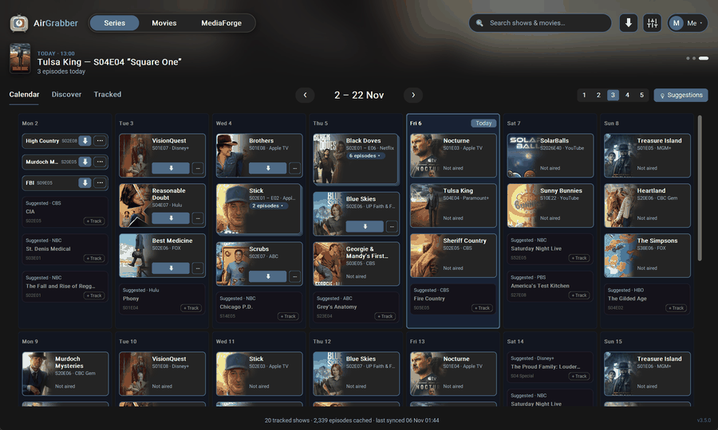
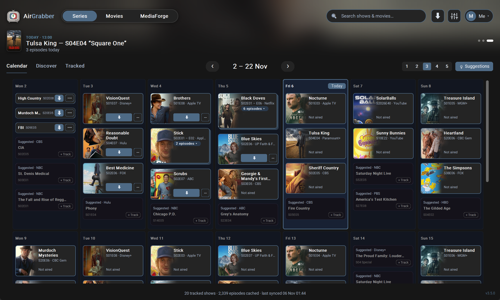
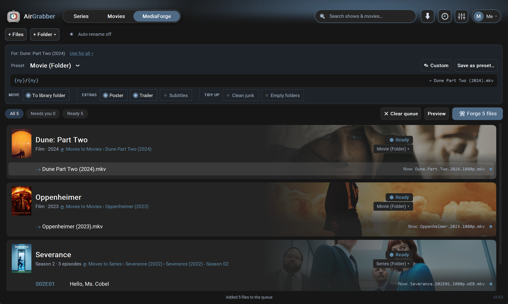

<p align="center"></p>

<h1 align="center">AirGrabber</h1>

<p align="center">
  <b>Never miss an episode. Keep your library tidy.</b><br>
  A free Windows app that shows when your series air, finds them, and names and files them for you.
</p>

<p align="center">
  <a href="#install"><b>Install</b></a> ·
  <a href="#what-it-does">What it does</a> ·
  <a href="#mediaforge">MediaForge</a> ·
  <a href="#safe-updates">Safe updates</a>
  <br><br>
  <a href="https://github.com/drunkgummyboy/AirGrabber/actions/workflows/tests.yml"></a>
</p>

<p align="center"></p>

## What it does

**Follow your series.** A calendar shows which episodes air this week, with Netflix, Disney+ and other
streaming shows on it too. Discover what's new and filter it by service.

<p align="center"></p>

<p align="center"></p>

**Rename everything properly: MediaForge.** A free, built-in renamer in the style of FileBot. Your own
naming format with visible codes, posters, trailers and subtitles. Turn on quality in the name, NFO files
or background pictures if your setup needs them. See every new name before anything changes, undo any run
later, and search your whole history.

<p align="center"></p>

**Search and send.** Search several torrent indexers at once, or your own Prowlarr, and
send a result to qBittorrent, Transmission or Synology Download Station with one click.

**Fits what you already use.** Connect Plex to see what you have and what's missing. Everyone at home can
have their own list. Light and dark look, English and Dutch.

| | |
|---|---|
| **Price** | Free, no account, no ads |
| **Licence** | Open source, [MIT](LICENSE) |
| **Runs on** | Windows 10 and 11 |
| **Your data** | Stays on your PC |
| **Optional** | A free [TMDB key](https://www.themoviedb.org/settings/api) unlocks Discover, pictures and MediaForge's names; the app walks you through it |

> AirGrabber doesn't host, store or share any video. What you download is up to you: only download what
> you're allowed to where you live.

Series and film information and pictures come from [TVmaze](https://www.tvmaze.com) and
[TMDB](https://www.themoviedb.org). This product uses the TMDB API but is not endorsed or certified by
TMDB. The pictures above show real shows and films; their posters belong to their owners.

## Install

On Windows 10 or 11:

1. Click **Start**, type **powershell** and open **Windows PowerShell**.
2. Copy this line, paste it into the blue window (Ctrl+V or right-click) and press **Enter**:

   ```
   irm is.gd/airgrabber | iex
   ```

3. Follow the questions.

AirGrabber then appears in the Start menu and on your desktop, and opens by itself. MediaForge gets
its own Start-menu entry and an entry in the right-click menu of files and folders. If you don't have
Python yet (the program AirGrabber runs on), the installer adds it for you. If you have no torrent
program yet, it also installs qBittorrent (the free program AirGrabber downloads with) and sets it up
so downloads start with one click, without a pop-up for each one; a torrent program you already have
is left alone. It also asks whether to add a free helper program (Prowlarr) that searches more
websites; you can say no.

To install without qBittorrent, use this line instead:

```
& ([scriptblock]::Create((irm is.gd/airgrabber))) -NoQBittorrent
```

Only paste commands like this from sources you trust. This one downloads AirGrabber's installer,
[`install.ps1`](install.ps1), from this page; you can read it first. `is.gd/airgrabber` is a short
link to it; the same command with the full address is:

```
irm https://raw.githubusercontent.com/drunkgummyboy/AirGrabber/main/install.ps1 | iex
```

## Safe updates

AirGrabber updates itself: new versions download in the background and install when you close it.
You can also check under ⚙ Settings → **Check for updates**. Your library and settings are kept.

- **Tested first.** Every version has to pass thousands of automatic tests before anyone gets it.
- **A way back.** If a new version won't start, AirGrabber returns to the one before by itself. If it
  starts but you don't like it, choose **Go back to version …** under ⚙ Settings → Updates. It then waits
  for a newer version.

## Uninstall

Open Windows **Settings → Apps → Installed apps**, find **AirGrabber** and choose **Uninstall**.

Windows then asks whether to **also delete your library and settings** (your followed shows,
download history and settings):

- Answer **No** to keep them. If you install AirGrabber again later, everything is still there.
- Answer **Yes** only if you want them gone for good.

MediaForge's Start-menu entry and right-click menu go with it. Python and helper programs (like
qBittorrent and Prowlarr) stay installed; remove them the same way if you no longer need them.

## MediaForge

MediaForge renames downloaded episodes and films with their official names from TMDB (for example
`Gold Rush (2010) - S17E05 - The Big Pour.mkv`) and moves them into your Series and Movies folders, with
posters and, if you want, trailers. Every rename can be undone.

**Opening it**: **MediaForge** in the Series · Movies · MediaForge switch of AirGrabber's window
(its amber number says how many files need you), **Open MediaForge** in the tray icon's menu, or
**MediaForge** in the Start menu. Drag files or folders from Explorer anywhere onto AirGrabber's
window to add them. The 🕘 at the top shows the History of what was renamed, where every run can be
undone.

**The right-click menu**: select files or folders in Explorer, right-click and choose
**MediaForge → Forge: <preset>** (on Windows 11 first **Show more options**). A small window shows
the new names; nothing is renamed until you click **Rename**. It works while AirGrabber is closed
too. Turn it on or off under ⚙ Settings → **MediaForge → Right-click menu**.

**Renaming on its own**: under ⚙ Settings → **MediaForge → Auto-rename**, choose your Series
and Movies folders and the folders to watch (AirGrabber's own download folder can be watched for
you). **Manual** puts the downloads it finds in the queue and moves nothing until you forge them; **On** renames finished
downloads by itself. Subtitles next to a download move along with it, and the
Downloads page shows the download as finished with where it went ("Renamed → Series › …").

### Coming from the old MediaForge

1. Install AirGrabber as above and close the old MediaForge.
2. Open MediaForge from AirGrabber. It asks **Bring over your MediaForge settings, presets and
   history?**: choose **Bring over**. (Not now? It asks again next time, and ⚙ Settings →
   MediaForge → Auto-rename has a **Bring over…** button.) Your TMDB key comes along when
   AirGrabber doesn't have one yet.
3. Choose **Remove the old MediaForge** (offered after the import, and in ⚙ Settings → MediaForge
   while the old one is installed). Until it is removed, AirGrabber's MediaForge doesn't rename
   anything on its own, so the two never move the same files. The old MediaForge's data is never
   deleted.

**Licences**: AirGrabber itself is under the [MIT licence](LICENSE). MediaForge reads file names with [guessit](https://github.com/guessit-io/guessit) and
rebulk (LGPL), installed by Python's package installer, not copied into AirGrabber. For trailers it
downloads [yt-dlp](https://github.com/yt-dlp/yt-dlp) (Unlicense) and
[ffmpeg](https://github.com/yt-dlp/FFmpeg-Builds) (GPL) from their GitHub releases the first time
you ask for one, checks them against their published checksums, and keeps them in AirGrabber's data
folder.

## AirGrabber 1.x

`airgrabber.py` is the old single-file version. It stays here so 1.x copies can still update
themselves.

## Development

```powershell
python main.py                                  # run from a checkout
python -m unittest discover -s tests -t .       # tests
python -m mypy                                  # strict type check
```

A checkout (anything with a `tests` folder) never updates itself; see `CLAUDE.md` for the project rules.
